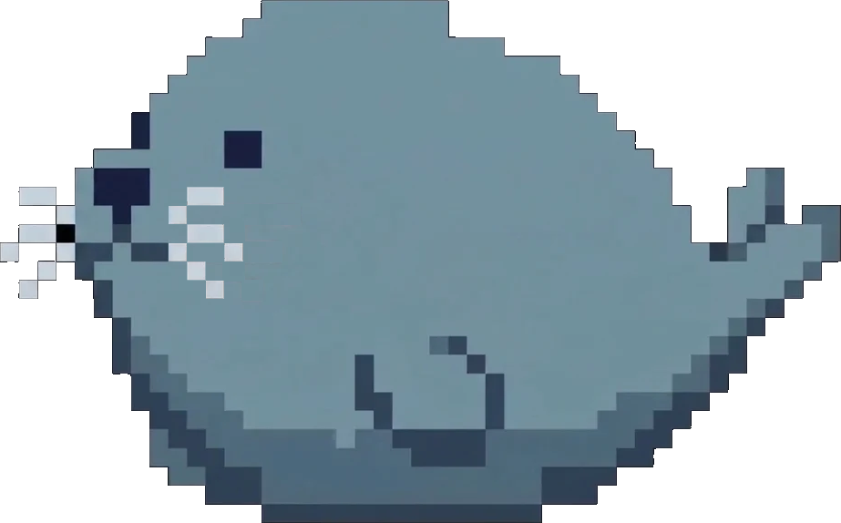

  

# ChonkOS

A minimal Linux setup built on Debian 13 (trixie) for daily development and homelab use.

## Goals
- Low RAM footprint and no preinstalled bloat
- Custom CLI tools and configs maintained in one repo
- Signed APT repository for clean updates

## Packages
- `chonkos-branding` — system identity and Chonky fastfetch config
- `chonkos-core` — base CLI toolset
- `chonkos-tools` — `chonk` and `scale` CLI tools (see [docs/TOOLS.md](docs/TOOLS.md))

## Status
Early work in progress (0.1).
